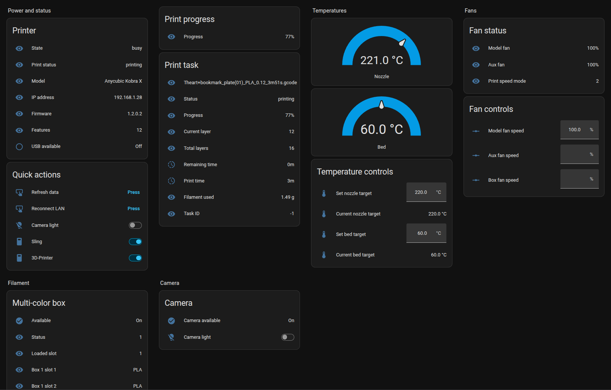

# Anycubic Kobra X LAN

A Home Assistant custom integration for monitoring and controlling an Anycubic Kobra X printer over the local LAN.

This integration is focused on local printer access. It does not require an Anycubic cloud account for normal operation.



## Features

- Local setup by printer IP address
- Printer state, model, IP and firmware sensors
- Nozzle and bed temperature sensors and controls (also while idle)
- Fan speed sensors and controls (also while idle)
- Print task, status, progress, layers, times, estimated finish, filament used
- Print control: pause, resume, cancel
- Print speed mode select (only while printing) and print speed sensor
- Binary sensors: printing, paused, complete, failed, cancelled, LAN connection
- Multi-color box (ACE): status, temperature, humidity, dynamic slot sensors
- Filament drying: start/stop buttons, drying temperature and duration settings, drying state and remaining time
- Runout auto refill switch, retract filament button
- Axis homing, disable motors and position sensors (disabled by default)
- Camera entity (auto-starts the printer stream) and camera stream switch
- Camera light control
- Refresh data and reconnect buttons
- **Print event** entity (`started`, `paused`, `resumed`, `finished`, `stopped`, `failed`, `error`) for notifications
- **Pause reason** sensor: why the printer paused or stopped (e.g. *Filament is stuck*, *Spaghetti detected*)
- **Print preview** and **plate view** images of the running job (requested from the printer with `file/fileDetails`)
- Firmware version shown on the device page
- **Kobra X printer card**: a bundled Lovelace card that draws the printer and its color unit with live values (see below)
- Services: `move_axis`, `start_drying`, `stop_drying`, `refresh_data`, `reconnect`
- Diagnostics support

Command payloads follow AnycubicSlicerNext's LAN (MQTT) commands, as mapped by
[anycubic-cloud-api](https://pypi.org/project/anycubic-cloud-api/) used by
[Nino6689/hass-anycubic](https://github.com/Nino6689/hass-anycubic). Not every
printer answers every command; entities stay unknown when the printer does not
report the value.

## Not included

- Firmware update checks
- Print upload/start and file management
- Filament loading, slot colour/material editing
- AI detection settings (the printer only accepts these over the cloud)
- Cloud account features

## Kobra X printer card


The integration ships a dashboard card and loads it automatically, no extra HACS resource is needed
(after an update, reload the browser once). Add it from the card picker (search for **Kobra X**) or in YAML:

```yaml
type: custom:kobra-x-printer-card
# device: <device id>   # optional, the first Kobra X LAN printer is used without it
view: printer                        # printer | details | camera
```

- `view: printer` – the Kobra X drawn as one picture: the built-in 4-color unit on top with every spool in its
  real filament colour and a ring for the remaining amount (the loaded spool pulses), expansion boxes above
  it with humidity, temperature and drying state, the part growing on the bed in the filament colour, the X
  gantry rising with the layers, the toolhead moving while printing, nozzle/bed/fan values, light and camera
  toggles, job thumbnail, progress, layer, remaining time and finish time.
- `view: details` – pause / resume / cancel with confirmation, light, camera, smart plug, print speed modes,
  job preview, filament list per box with drying and auto refill controls, value tiles (nozzle, bed, fans,
  job, health with pause reason and last error, connection, power).
- `view: camera` – the live camera with status and temperatures on top.

| Option | Default | Description |
|---|---|---|
| `device` | first printer | The printer device; without it the card uses the first Kobra X LAN printer |
| `view` | `printer` | `printer`, `details` or `camera` |
| `plug` | – | Smart plug of the printer, shown as a button with confirmation |
| `power` | – | Power sensor of the plug |
| `preview` | `true` | Show the job thumbnail |
| `language` | `auto` | `auto`, `cs` or `en` |

The card finds entities through the device and their stable keys, so renamed entities keep working.
Idea and layout inspired by [ossilampe/bambu-printer-card](https://github.com/ossilampe/bambu-printer-card) (MIT).

## Complete dashboard (copy & paste)

Every entity of the integration on one page, with the printer card, camera, job, temperatures,
fans, filament, drying, axes and diagnostics. The file is also in
[`dashboards/kobra_x_dashboard.yaml`](dashboards/kobra_x_dashboard.yaml).

1. **Settings → Dashboards → Add dashboard → New dashboard from scratch**, open it.
2. **⋮ → Edit dashboard → ⋮ → Raw configuration editor**, replace everything with the YAML below, **Save**.

Nothing needs changing as long as the printer device kept its default name *Anycubic Kobra X*
(the card finds the printer on its own). Axis buttons and axis position sensors are disabled by
default; enable them on the device page if you want the *Osy* section.

```yaml
# Anycubic Kobra X – complete dashboard with every entity of the integration.
# Settings → Dashboards → Add dashboard → New dashboard from scratch → open it →
# ⋮ → Edit dashboard → ⋮ → Raw configuration editor → paste this whole file → Save.
# Entity IDs assume the default device name "Anycubic Kobra X".
# Axis buttons and axis position sensors are disabled by default in the integration:
# enable them on the device page (Settings → Devices → Anycubic Kobra X), otherwise the
# "Osy" section shows them as unavailable.
views:
  - title: Kobra X
    path: kobra-x
    icon: mdi:printer-3d
    type: sections
    max_columns: 4
    sections:
      # ---------- printer picture + camera ----------
      - type: grid
        cards:
          - type: heading
            heading: Tiskárna
            icon: mdi:printer-3d
          - type: custom:kobra-x-printer-card
            view: printer
            grid_options:
              columns: full
          - type: picture-entity
            entity: camera.anycubic_kobra_x_camera
            name: Kamera
            camera_view: live
            show_state: false
            grid_options:
              columns: full
          - type: tile
            entity: switch.anycubic_kobra_x_camera_stream
            name: Stream kamery
          - type: tile
            entity: light.anycubic_kobra_x_camera_light
            name: Světlo kamery

      # ---------- controls, filament, values ----------
      - type: grid
        cards:
          - type: heading
            heading: Ovládání
            icon: mdi:gesture-tap-button
          - type: custom:kobra-x-printer-card
            view: details
            grid_options:
              columns: full

      # ---------- print job ----------
      - type: grid
        cards:
          - type: heading
            heading: Tisková úloha
            icon: mdi:file-cad-box
          - type: tile
            entity: sensor.anycubic_kobra_x_print_progress
            name: Průběh
            grid_options:
              columns: full
          - type: entities
            show_header_toggle: false
            entities:
              - entity: sensor.anycubic_kobra_x_print_task
                name: Úloha
              - entity: sensor.anycubic_kobra_x_print_status
                name: Stav tisku
              - entity: sensor.anycubic_kobra_x_printer_state
                name: Stav tiskárny
              - entity: sensor.anycubic_kobra_x_current_layer
                name: Aktuální vrstva
              - entity: sensor.anycubic_kobra_x_total_layers
                name: Vrstev celkem
              - entity: sensor.anycubic_kobra_x_remaining_print_time
                name: Zbývá
              - entity: sensor.anycubic_kobra_x_print_time
                name: Doba tisku
              - entity: sensor.anycubic_kobra_x_estimated_finish
                name: Hotovo v
                format: time
              - entity: sensor.anycubic_kobra_x_filament_used
                name: Spotřeba filamentu
              - entity: sensor.anycubic_kobra_x_task_id
                name: ID úlohy
          - type: entities
            title: Rychlost
            show_header_toggle: false
            entities:
              - entity: select.anycubic_kobra_x_print_speed_mode
                name: Režim rychlosti
              - entity: sensor.anycubic_kobra_x_print_speed_mode_name
                name: Název režimu
              - entity: sensor.anycubic_kobra_x_print_speed_mode
                name: Číslo režimu
              - entity: sensor.anycubic_kobra_x_print_speed
                name: Rychlost
          - type: entities
            title: Řízení tisku
            show_header_toggle: false
            entities:
              - entity: button.anycubic_kobra_x_pause_print
                name: Pozastavit
              - entity: button.anycubic_kobra_x_resume_print
                name: Pokračovat
              - entity: button.anycubic_kobra_x_cancel_print
                name: Zrušit tisk
          - type: entities
            title: Stav
            show_header_toggle: false
            entities:
              - entity: binary_sensor.anycubic_kobra_x_printing
                name: Tiskne
              - entity: binary_sensor.anycubic_kobra_x_print_paused
                name: Pozastaveno
              - entity: binary_sensor.anycubic_kobra_x_print_complete
                name: Dokončeno
              - entity: binary_sensor.anycubic_kobra_x_print_failed
                name: Selhalo
              - entity: binary_sensor.anycubic_kobra_x_print_cancelled
                name: Zrušeno
              - entity: event.anycubic_kobra_x_print_event
                name: Poslední událost
              - entity: sensor.anycubic_kobra_x_pause_reason
                name: Důvod pauzy
              - entity: sensor.anycubic_kobra_x_last_print_error
                name: Poslední chyba
          - type: picture-entity
            entity: image.anycubic_kobra_x_print_preview
            name: Náhled modelu
            show_state: false
          - type: picture-entity
            entity: image.anycubic_kobra_x_print_plate_view
            name: Pohled na podložku
            show_state: false

      # ---------- temperatures and fans ----------
      - type: grid
        cards:
          - type: heading
            heading: Teploty a ventilátory
            icon: mdi:thermometer
          - type: gauge
            entity: sensor.anycubic_kobra_x_nozzle_temperature
            name: Tryska
            min: 0
            max: 300
            needle: true
            severity:
              green: 0
              yellow: 170
              red: 260
          - type: gauge
            entity: sensor.anycubic_kobra_x_bed_temperature
            name: Podložka
            min: 0
            max: 110
            needle: true
            severity:
              green: 0
              yellow: 50
              red: 90
          - type: entities
            title: Teploty
            show_header_toggle: false
            entities:
              - entity: number.anycubic_kobra_x_target_nozzle_temperature
                name: Nastavit trysku
              - entity: sensor.anycubic_kobra_x_target_nozzle_temperature
                name: Cíl trysky
              - entity: number.anycubic_kobra_x_target_bed_temperature
                name: Nastavit podložku
              - entity: sensor.anycubic_kobra_x_target_bed_temperature
                name: Cíl podložky
          - type: entities
            title: Ventilátory
            show_header_toggle: false
            entities:
              - entity: sensor.anycubic_kobra_x_fan_speed
                name: Ventilátor modelu
              - entity: number.anycubic_kobra_x_model_fan_speed
                name: Nastavit ventilátor modelu
              - entity: sensor.anycubic_kobra_x_aux_fan_speed
                name: Přídavný ventilátor
              - entity: number.anycubic_kobra_x_aux_fan_speed
                name: Nastavit přídavný
              - entity: number.anycubic_kobra_x_box_fan_speed
                name: Ventilátor boxu
          - type: history-graph
            title: Teploty – 6 h
            hours_to_show: 6
            entities:
              - entity: sensor.anycubic_kobra_x_nozzle_temperature
                name: Tryska
              - entity: sensor.anycubic_kobra_x_bed_temperature
                name: Podložka

      # ---------- filament / color unit ----------
      - type: grid
        cards:
          - type: heading
            heading: Filament
            icon: mdi:palette-swatch-variant
          - type: entities
            title: Barevná jednotka
            show_header_toggle: false
            entities:
              - entity: binary_sensor.anycubic_kobra_x_multi_color_box_available
                name: Dostupná
              - entity: sensor.anycubic_kobra_x_multi_color_box_status
                name: Stav
              - entity: sensor.anycubic_kobra_x_loaded_slot
                name: Zavedený slot
              - entity: sensor.anycubic_kobra_x_box_1_slot_1
                name: Slot 1
              - entity: sensor.anycubic_kobra_x_box_1_slot_2
                name: Slot 2
              - entity: sensor.anycubic_kobra_x_box_1_slot_3
                name: Slot 3
              - entity: sensor.anycubic_kobra_x_box_1_slot_4
                name: Slot 4
              - entity: sensor.anycubic_kobra_x_multi_color_box_temperature
                name: Teplota
              - entity: sensor.anycubic_kobra_x_multi_color_box_humidity
                name: Vlhkost
              - entity: switch.anycubic_kobra_x_runout_auto_refill
                name: Automatické doplnění
              - entity: button.anycubic_kobra_x_retract_filament
                name: Vytáhnout filament
          - type: entities
            title: Sušení
            show_header_toggle: false
            entities:
              - entity: binary_sensor.anycubic_kobra_x_drying
                name: Suší
              - entity: number.anycubic_kobra_x_drying_temperature
                name: Teplota sušení
              - entity: number.anycubic_kobra_x_drying_duration
                name: Doba sušení
              - entity: button.anycubic_kobra_x_start_drying
                name: Spustit sušení
              - entity: button.anycubic_kobra_x_stop_drying
                name: Zastavit sušení
              - entity: sensor.anycubic_kobra_x_drying_target_temperature
                name: Cílová teplota
              - entity: sensor.anycubic_kobra_x_drying_duration
                name: Nastavená doba
              - entity: sensor.anycubic_kobra_x_drying_remaining_time
                name: Zbývá sušit

      # ---------- axes ----------
      - type: grid
        cards:
          - type: heading
            heading: Osy
            icon: mdi:axis-arrow
          - type: entities
            show_header_toggle: false
            entities:
              - entity: button.anycubic_kobra_x_home_all_axes
                name: Domů všechny osy
              - entity: button.anycubic_kobra_x_home_x_y
                name: Domů X/Y
              - entity: button.anycubic_kobra_x_home_z
                name: Domů Z
              - entity: button.anycubic_kobra_x_disable_motors
                name: Vypnout motory
              - entity: button.anycubic_kobra_x_read_axis_position
                name: Načíst polohu
              - entity: binary_sensor.anycubic_kobra_x_axis_moving
                name: Osy v pohybu
              - entity: sensor.anycubic_kobra_x_axis_position_x
                name: Poloha X
              - entity: sensor.anycubic_kobra_x_axis_position_y
                name: Poloha Y
              - entity: sensor.anycubic_kobra_x_axis_position_z
                name: Poloha Z
          - type: horizontal-stack
            cards:
              - type: button
                name: X −10
                icon: mdi:arrow-left
                tap_action:
                  action: perform-action
                  perform_action: anycubic_kobra_x_lan.move_axis
                  data:
                    axis: x
                    distance: -10
              - type: button
                name: X +10
                icon: mdi:arrow-right
                tap_action:
                  action: perform-action
                  perform_action: anycubic_kobra_x_lan.move_axis
                  data:
                    axis: x
                    distance: 10
              - type: button
                name: Y −10
                icon: mdi:arrow-down
                tap_action:
                  action: perform-action
                  perform_action: anycubic_kobra_x_lan.move_axis
                  data:
                    axis: y
                    distance: -10
              - type: button
                name: Y +10
                icon: mdi:arrow-up
                tap_action:
                  action: perform-action
                  perform_action: anycubic_kobra_x_lan.move_axis
                  data:
                    axis: y
                    distance: 10
          - type: horizontal-stack
            cards:
              - type: button
                name: Z −1
                icon: mdi:arrow-collapse-down
                tap_action:
                  action: perform-action
                  perform_action: anycubic_kobra_x_lan.move_axis
                  data:
                    axis: z
                    distance: -1
              - type: button
                name: Z +1
                icon: mdi:arrow-collapse-up
                tap_action:
                  action: perform-action
                  perform_action: anycubic_kobra_x_lan.move_axis
                  data:
                    axis: z
                    distance: 1
              - type: button
                name: Z +10
                icon: mdi:arrow-expand-up
                tap_action:
                  action: perform-action
                  perform_action: anycubic_kobra_x_lan.move_axis
                  data:
                    axis: z
                    distance: 10

      # ---------- device / diagnostics ----------
      - type: grid
        cards:
          - type: heading
            heading: Zařízení
            icon: mdi:information-outline
          - type: entities
            show_header_toggle: false
            entities:
              - entity: binary_sensor.anycubic_kobra_x_lan_connection
                name: LAN spojení
              - entity: sensor.anycubic_kobra_x_model
                name: Model
              - entity: sensor.anycubic_kobra_x_ip_address
                name: IP adresa
              - entity: sensor.anycubic_kobra_x_firmware_version
                name: Firmware
              - entity: sensor.anycubic_kobra_x_features
                name: Funkce
              - entity: binary_sensor.anycubic_kobra_x_camera_available
                name: Kamera dostupná
              - entity: binary_sensor.anycubic_kobra_x_usb_available
                name: USB dostupné
              - entity: button.anycubic_kobra_x_refresh_data
                name: Obnovit data
              - entity: button.anycubic_kobra_x_reconnect_lan_connection
                name: Znovu připojit LAN
          - type: logbook
            title: Události tisku
            hours_to_show: 48
            entities:
              - event.anycubic_kobra_x_print_event
              - sensor.anycubic_kobra_x_print_status
```

## Print events

`event.<printer>_print_event` fires on every change of the job. Paused, stopped and `error` carry
`reason_code` and `reason`; `error` fires once for a fault the user did not cause (clog, tangle, spaghetti).

```yaml
automation:
  - alias: Printer needs attention
    triggers:
      - trigger: state
        entity_id: event.anycubic_kobra_x_print_event
    conditions:
      - condition: template
        value_template: "{{ trigger.to_state.attributes.event_type in ['error', 'failed', 'finished'] }}"
    actions:
      - action: notify.mobile_app_your_phone
        data:
          title: "Kobra X: {{ trigger.to_state.attributes.event_type }}"
          message: "{{ trigger.to_state.attributes.reason | default(trigger.to_state.attributes.task) }}"
```

## Installation with HACS

This integration can be installed as a custom HACS repository.

1. Open Home Assistant.
2. Open HACS.
3. Open the three-dot menu.
4. Choose **Custom repositories**.
5. Add this repository URL.
6. Select category **Integration**.
7. Install **Anycubic Kobra X LAN**.
8. Restart Home Assistant.
9. Go to **Settings → Devices & services**.
10. Choose **Add integration**.
11. Search for **Anycubic Kobra X LAN**.
12. Enter your printer IP address.

## Setup

You need the printer IP address on your local network.

During setup, the integration connects to the printer, discovers the local LAN credentials, and shows the printer model before saving the integration.

Your Home Assistant instance and printer must be on the same local network.

## Supported printer

Tested and confirmed:

- Anycubic Kobra X
- Anycubic Kobra S1

The AnycubicSlicerNext LAN code also contains configuration for the following models, but they have not been tested with this integration yet:

- Anycubic Kobra 2 Pro
- Anycubic Kobra 2 Plus
- Anycubic Kobra 2 Max
- Anycubic Kobra 3
- Anycubic Kobra 3 Max
- Anycubic Kobra 4
- Anycubic Kobra S1 Max

These printers may use a similar LAN/MQTT protocol, but support is not confirmed until someone tests them. If you test one and it's working or not working please get back to me so I can update this list.

## Camera

The integration exposes `camera.<printer>_camera` and a `switch.<printer>_camera_stream`.

How the printer camera works:

- The printer serves the video as HTTP-FLV on port `18088` (`http://<printer-ip>:18088/flv`), but **only after it receives the MQTT command `startCapture`**.
- After a printer reboot (or when the printer drops the LAN connection) the capture is stopped again. This is printer behaviour, not a bug. A camera added by hand (Generic camera / go2rtc with the URL pasted in) therefore stays idle with no picture after a restart.
- The camera entity sends `startCapture` every time Home Assistant opens the stream, and again automatically after the LAN connection reconnects if the camera was viewed in the last 10 minutes.
- The Kobra X answers the FLV request with `206 Partial Content`, which ffmpeg/go2rtc refuse. The stream is relayed through Home Assistant with a `200` response so it plays in the normal camera cards.
- Snapshots are taken from the running stream (the printer has no snapshot endpoint).

Show it on a dashboard with a Picture Entity card in live mode:

```yaml
type: picture-entity
entity: camera.anycubic_kobra_x_camera
camera_view: live
show_state: false
```

If the picture stays black, toggle **Camera stream** off and on, or press **Reconnect LAN connection**. Only one client can usually hold the stream; close AnycubicSlicerNext's camera view if it is open.

Camera light control is exposed separately as a light entity. See [`example_dashboard`](example_dashboard) for a full dashboard.

## Controls

- Set target nozzle/bed temperature. While printing this changes the job settings, while idle it preheats (`tempature/set`). Set to `0` to turn heating off.
- Set model, aux and box fan speed.
- Pause, resume and cancel the running print. Buttons are unavailable when the action does not apply.
- Print speed mode. The printer only accepts it during a print.
- Filament drying: set **Drying temperature** and **Drying duration**, then press **Start drying**. The `start_drying` service accepts temperature, duration and box directly.
- Runout auto refill switch and retract filament button per multi-color box.
- Axis: home all / home X/Y / home Z / disable motors buttons and the `move_axis` service. These are disabled by default and refused while printing.
- Turn camera light on/off.

## Safety notes

All commands are sent directly to the printer over LAN.

Axis movement buttons are disabled by default. The printer ignores jogs until it has been homed; keep moves small and watch the printer.

## Local-only focus

This integration is designed around local LAN communication. Firmware checks and cloud features are intentionally not included in the first release.

## Troubleshooting

If the integration cannot connect, check that:

```text
The printer is turned on
The printer is connected to the same network as Home Assistant
LAN mode is enabled on the printer
The printer IP address is correct
No firewall is blocking local access
```

If the printer IP changes, you may need to remove and add the integration again, or set a fixed IP address for the printer in your router.

## Privacy

Printer data is read locally from your network.

This integration is not affiliated with Anycubic and does not send printer data to Anycubic cloud services for normal operation.

## Research and protocol notes

This Home Assistant integration is kept focused on the actual HACS implementation.

The reverse engineering notes, protocol research, test scripts, and technical explanations are kept in a separate research repository:

[anycubic-kobra-x-lan research repository](https://gitlab.com/grunna/anycubic-kobra-x-lan)

That repository contains more details about how the local LAN communication works, including MQTT topics, payloads, credential discovery, camera handling, and other protocol notes.

You do not need the research repository to use this integration. It is mainly intended for developers, contributors, and anyone who wants to understand or verify how the integration communicates with the printer.

## License

MIT License

## Disclaimer

This project is unofficial and not affiliated with Anycubic.

Use at your own risk. Printer firmware and local protocols may change over time.
