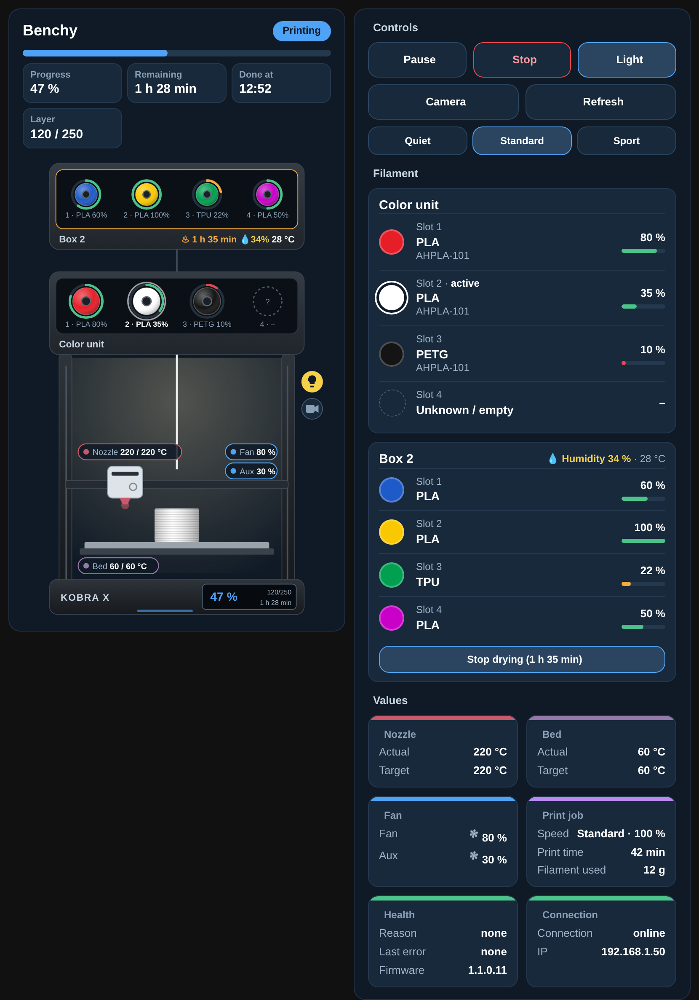

# Anycubic Kobra X LAN

A Home Assistant custom integration for monitoring and controlling an Anycubic Kobra X printer over the local LAN.

This integration is focused on local printer access. It does not require an Anycubic cloud account for normal operation.


## Features

- Local setup by printer IP address
- Printer state, model, IP and firmware sensors
- Nozzle and bed temperature sensors and controls (also while idle)
- Fan speed sensors and controls (also while idle)
- Print task, status, progress, layers, times, estimated finish, filament used
- Print control: pause, resume, cancel
- Print speed mode select (only while printing) and print speed sensor
- Binary sensors: printing, paused, complete, failed, cancelled, LAN connection
- Multi-color box (ACE): status, temperature, humidity, dynamic slot sensors
- Filament drying: start/stop buttons, drying temperature and duration settings, drying state and remaining time
- Runout auto refill switch, retract filament button
- Axis homing, disable motors and position sensors (disabled by default)
- Camera entity (auto-starts the printer stream) and camera stream switch
- Camera light control
- Refresh data and reconnect buttons
- **Print event** entity (`started`, `paused`, `resumed`, `finished`, `stopped`, `failed`, `error`) for notifications
- **Pause reason** sensor: why the printer paused or stopped (e.g. *Filament is stuck*, *Spaghetti detected*)
- **Print preview** and **plate view** images of the running job (requested from the printer with `file/fileDetails`)
- Firmware version shown on the device page
- **Kobra X printer card**: a bundled Lovelace card that draws the printer and its color unit with live values (see below)
- Services: `move_axis`, `start_drying`, `stop_drying`, `refresh_data`, `reconnect`
- Diagnostics support

Command payloads follow AnycubicSlicerNext's LAN (MQTT) commands, as mapped by
[anycubic-cloud-api](https://pypi.org/project/anycubic-cloud-api/) used by
[Nino6689/hass-anycubic](https://github.com/Nino6689/hass-anycubic). Not every
printer answers every command; entities stay unknown when the printer does not
report the value.

## Not included

- Firmware update checks
- Print upload/start and file management
- Filament loading, slot colour/material editing
- AI detection settings (the printer only accepts these over the cloud)
- Cloud account features

## Kobra X printer card



The integration ships a dashboard card and loads it automatically, no extra HACS resource is needed
(after an update, reload the browser once). Add it from the card picker (search for **Kobra X**) or in YAML:

```yaml
type: custom:kobra-x-printer-card
device: <device id of the printer>   # the card editor fills it in
view: printer                        # printer | details | camera
```

- `view: printer` – the Kobra X drawn as one picture: the built-in 4-color unit on top with every spool in its
  real filament colour and a ring for the remaining amount (the loaded spool pulses), expansion boxes above
  it with humidity, temperature and drying state, the part growing on the bed in the filament colour, the X
  gantry rising with the layers, the toolhead moving while printing, nozzle/bed/fan values, light and camera
  toggles, job thumbnail, progress, layer, remaining time and finish time.
- `view: details` – pause / resume / cancel with confirmation, light, camera, smart plug, print speed modes,
  job preview, filament list per box with drying and auto refill controls, value tiles (nozzle, bed, fans,
  job, health with pause reason and last error, connection, power).
- `view: camera` – the live camera with status and temperatures on top.

| Option | Default | Description |
|---|---|---|
| `device` | – | **Required.** The printer device |
| `view` | `printer` | `printer`, `details` or `camera` |
| `plug` | – | Smart plug of the printer, shown as a button with confirmation |
| `power` | – | Power sensor of the plug |
| `preview` | `true` | Show the job thumbnail |
| `language` | `auto` | `auto`, `cs` or `en` |

The card finds entities through the device and their stable keys, so renamed entities keep working.
Idea and layout inspired by [ossilampe/bambu-printer-card](https://github.com/ossilampe/bambu-printer-card) (MIT).

## Print events

`event.<printer>_print_event` fires on every change of the job. Paused, stopped and `error` carry
`reason_code` and `reason`; `error` fires once for a fault the user did not cause (clog, tangle, spaghetti).

```yaml
automation:
  - alias: Printer needs attention
    triggers:
      - trigger: state
        entity_id: event.anycubic_kobra_x_print_event
    conditions:
      - condition: template
        value_template: "{{ trigger.to_state.attributes.event_type in ['error', 'failed', 'finished'] }}"
    actions:
      - action: notify.mobile_app_your_phone
        data:
          title: "Kobra X: {{ trigger.to_state.attributes.event_type }}"
          message: "{{ trigger.to_state.attributes.reason | default(trigger.to_state.attributes.task) }}"
```

## Installation with HACS

This integration can be installed as a custom HACS repository.

1. Open Home Assistant.
2. Open HACS.
3. Open the three-dot menu.
4. Choose **Custom repositories**.
5. Add this repository URL.
6. Select category **Integration**.
7. Install **Anycubic Kobra X LAN**.
8. Restart Home Assistant.
9. Go to **Settings → Devices & services**.
10. Choose **Add integration**.
11. Search for **Anycubic Kobra X LAN**.
12. Enter your printer IP address.

## Setup

You need the printer IP address on your local network.

During setup, the integration connects to the printer, discovers the local LAN credentials, and shows the printer model before saving the integration.

Your Home Assistant instance and printer must be on the same local network.

## Supported printer

Tested and confirmed:

- Anycubic Kobra X
- Anycubic Kobra S1

The AnycubicSlicerNext LAN code also contains configuration for the following models, but they have not been tested with this integration yet:

- Anycubic Kobra 2 Pro
- Anycubic Kobra 2 Plus
- Anycubic Kobra 2 Max
- Anycubic Kobra 3
- Anycubic Kobra 3 Max
- Anycubic Kobra 4
- Anycubic Kobra S1 Max

These printers may use a similar LAN/MQTT protocol, but support is not confirmed until someone tests them. If you test one and it's working or not working please get back to me so I can update this list.

## Camera

The integration exposes `camera.<printer>_camera` and a `switch.<printer>_camera_stream`.

How the printer camera works:

- The printer serves the video as HTTP-FLV on port `18088` (`http://<printer-ip>:18088/flv`), but **only after it receives the MQTT command `startCapture`**.
- After a printer reboot (or when the printer drops the LAN connection) the capture is stopped again. This is printer behaviour, not a bug. A camera added by hand (Generic camera / go2rtc with the URL pasted in) therefore stays idle with no picture after a restart.
- The camera entity sends `startCapture` every time Home Assistant opens the stream, and again automatically after the LAN connection reconnects if the camera was viewed in the last 10 minutes.
- The Kobra X answers the FLV request with `206 Partial Content`, which ffmpeg/go2rtc refuse. The stream is relayed through Home Assistant with a `200` response so it plays in the normal camera cards.
- Snapshots are taken from the running stream (the printer has no snapshot endpoint).

Show it on a dashboard with a Picture Entity card in live mode:

```yaml
type: picture-entity
entity: camera.anycubic_kobra_x_camera
camera_view: live
show_state: false
```

If the picture stays black, toggle **Camera stream** off and on, or press **Reconnect LAN connection**. Only one client can usually hold the stream; close AnycubicSlicerNext's camera view if it is open.

Camera light control is exposed separately as a light entity. See [`example_dashboard`](example_dashboard) for a full dashboard.

## Controls

- Set target nozzle/bed temperature. While printing this changes the job settings, while idle it preheats (`tempature/set`). Set to `0` to turn heating off.
- Set model, aux and box fan speed.
- Pause, resume and cancel the running print. Buttons are unavailable when the action does not apply.
- Print speed mode. The printer only accepts it during a print.
- Filament drying: set **Drying temperature** and **Drying duration**, then press **Start drying**. The `start_drying` service accepts temperature, duration and box directly.
- Runout auto refill switch and retract filament button per multi-color box.
- Axis: home all / home X/Y / home Z / disable motors buttons and the `move_axis` service. These are disabled by default and refused while printing.
- Turn camera light on/off.

## Safety notes

All commands are sent directly to the printer over LAN.

Axis movement buttons are disabled by default. The printer ignores jogs until it has been homed; keep moves small and watch the printer.

## Local-only focus

This integration is designed around local LAN communication. Firmware checks and cloud features are intentionally not included in the first release.

## Troubleshooting

If the integration cannot connect, check that:

```text
The printer is turned on
The printer is connected to the same network as Home Assistant
LAN mode is enabled on the printer
The printer IP address is correct
No firewall is blocking local access
```

If the printer IP changes, you may need to remove and add the integration again, or set a fixed IP address for the printer in your router.

## Privacy

Printer data is read locally from your network.

This integration is not affiliated with Anycubic and does not send printer data to Anycubic cloud services for normal operation.

## Research and protocol notes

This Home Assistant integration is kept focused on the actual HACS implementation.

The reverse engineering notes, protocol research, test scripts, and technical explanations are kept in a separate research repository:

[anycubic-kobra-x-lan research repository](https://gitlab.com/grunna/anycubic-kobra-x-lan)

That repository contains more details about how the local LAN communication works, including MQTT topics, payloads, credential discovery, camera handling, and other protocol notes.

You do not need the research repository to use this integration. It is mainly intended for developers, contributors, and anyone who wants to understand or verify how the integration communicates with the printer.

## License

MIT License

## Disclaimer

This project is unofficial and not affiliated with Anycubic.

Use at your own risk. Printer firmware and local protocols may change over time.
